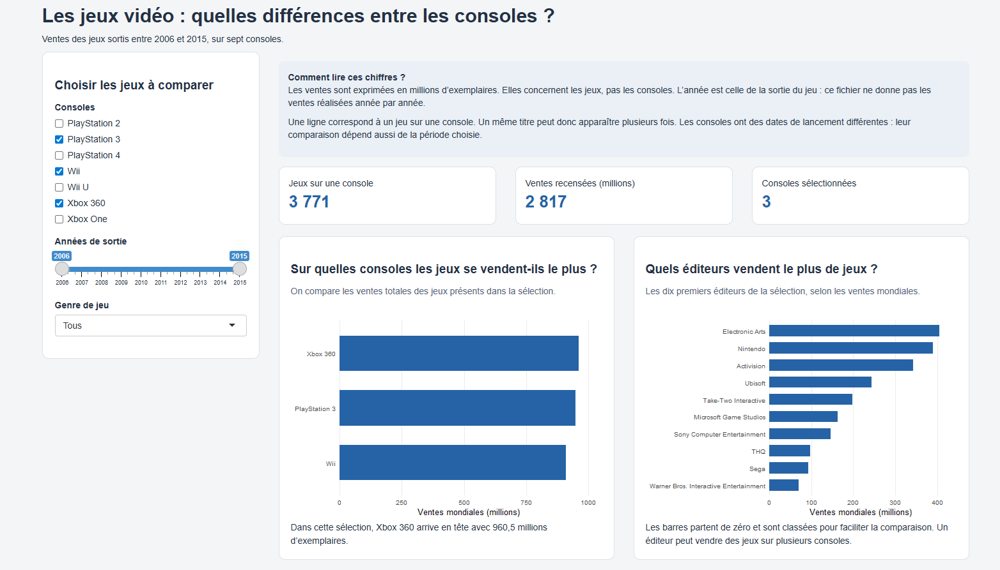
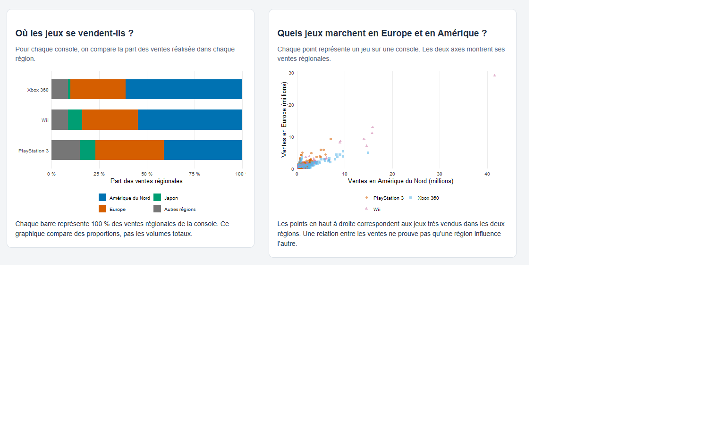
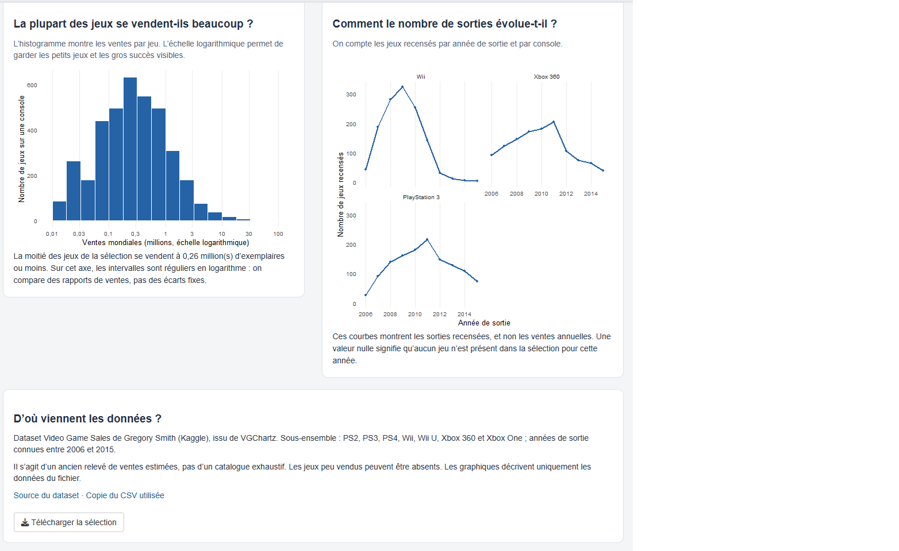

## Présentation du projet

Ce projet est un tableau de bord interactif réalisé avec **R Shiny**, qui permet de comparer les ventes de jeux vidéo sur plusieurs consoles entre 2006 et 2015.

Il contient six graphiques pour visualiser les ventes par console, par région, par éditeur ainsi que leur répartition et l'évolution des sorties de jeux.

Des filtres permettent de choisir les consoles, les années et les genres pour explorer les données plus facilement.

